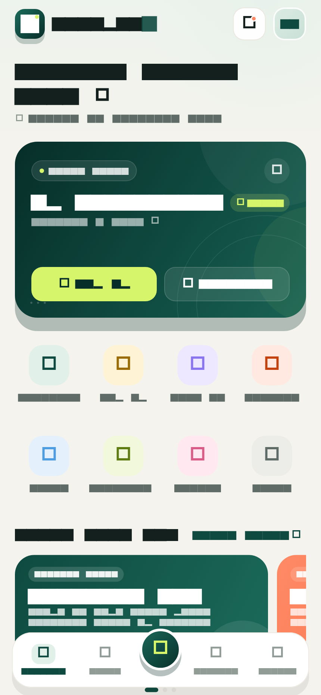
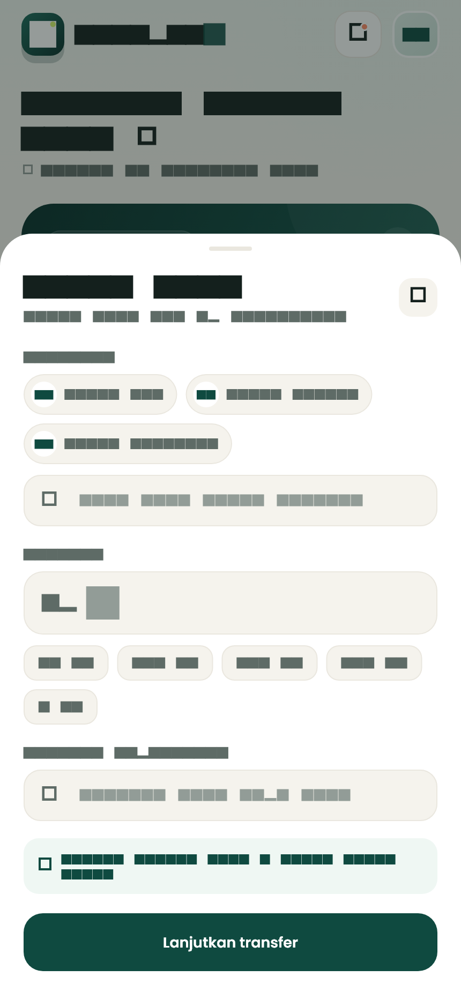
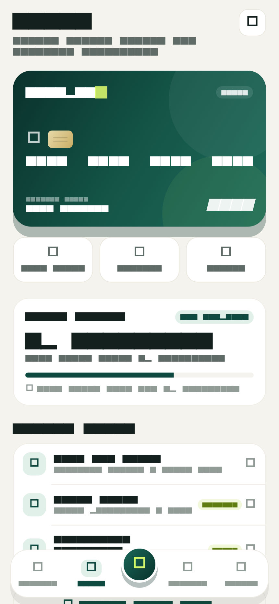
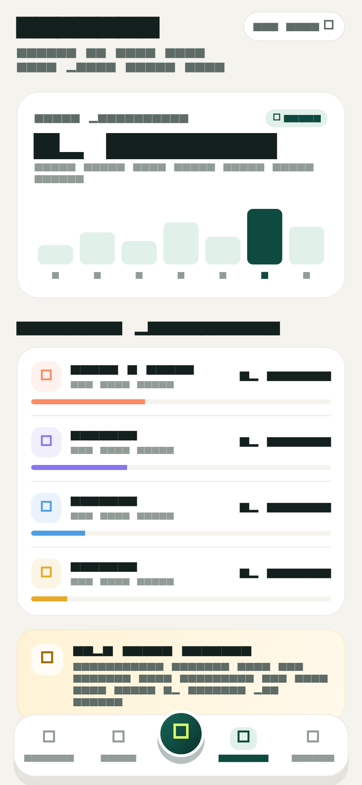
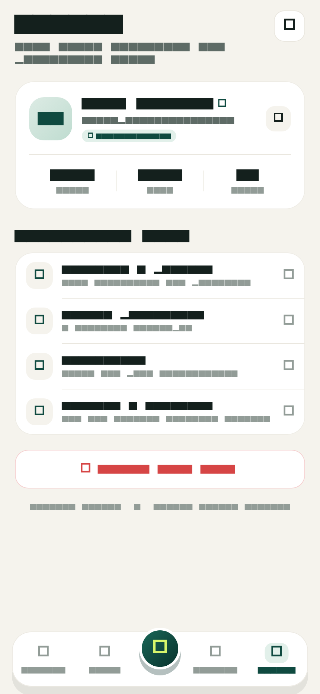

# NusaPay

> Redesain halaman utama dompet digital dengan Flutter — hangat, tenang, dan terasa manusiawi.

**NusaPay** adalah prototipe aplikasi dompet digital yang dibuat untuk **UTS Pemrograman Mobile 1**. Aplikasi ini menghadirkan ulang pengalaman membuka dompet digital: saldo yang mudah dibaca, aksi cepat yang jelas, promo yang tidak berisik, dan riwayat transaksi yang rapi — semuanya dibangun dengan Flutter tanpa dependensi runtime eksternal.


---

## Tangkapan layar

Klik gambar untuk membuka file asli beresolusi penuh.

### Beranda

[](docs/screenshots/01-home.png)

### Transfer & Top Up

[](docs/screenshots/02-transfer.png)

### Kartu

[](docs/screenshots/03-kartu.png)

### Insight

[](docs/screenshots/04-insight.png)

### Profil

[](docs/screenshots/05-profil.png)

---

## Latar belakang desain

Sebagian besar aplikasi keuangan memakai biru atau ungu dengan tampilan yang serba padat. NusaPay mencoba arah yang berbeda:

- **Warm cream canvas** (`#F7F4ED`) agar mata tidak cepat lelah.
- **Deep emerald** (`#0F4A40`) sebagai warna brand yang tenang dan terpercaya.
- **Lime accent** (`#D6F56B`) untuk momen penting: aksi utama, angka, dan sorotan.
- **Poppins** dengan hierarki tebal-tipis yang jelas, dibundel lokal agar tampilan konsisten di semua platform.
- Sudut membulat besar, ilustrasi lembut, dan ruang kosong yang cukup — mengurangi kesan "formulir bank".

Palet lengkap dapat dilihat di [`lib/theme/app_colors.dart`](lib/theme/app_colors.dart).

---

## Fitur

### Beranda

- Header personal dengan sapaan, notifikasi berbadge, dan pintasan profil.
- Kartu saldo dengan aksi **Top Up** dan **Transfer**, toggle sembunyikan saldo, serta nomor rekening.
- Grid 8 aksi cepat: Transfer, Top Up, Scan QR, Tagihan, Pulsa, Investasi, Donasi, dan Semua layanan.
- Carousel promo dengan detail dan syarat ketentuan.
- Daftar aktivitas terakhir dengan detail transaksi lengkap.
- Banner keamanan dan tarik-untuk-menyegarkan (pull to refresh).

### Alur uang yang benar-benar bekerja

- **Transfer** dan **Top Up** membuka bottom sheet dengan validasi nominal, cek saldo, dan konfirmasi.
- Saldo pada kartu utama langsung berubah setelah transaksi berhasil.
- Snackbar konfirmasi muncul untuk setiap aksi.

### Tab lain

- **Kartu** — kartu fisik virtual, status verifikasi, dan limit harian.
- **Insight** — ringkasan pemasukan/pengeluaran, grafik mingguan, dan kategori pengeluaran.
- **Profil** — data akun, keamanan, pengaturan, dan dialog keluar.

### Detail kecil yang membuat terasa hidup

- Scanner QRIS animasi dengan garis pindai dan simulasi hasil.
- Pusat notifikasi dengan status belum dibaca.
- Lembar promo berisi daftar promo dan halaman detail.
- Transisi, ripple, dan animasi masuk yang halus di seluruh aplikasi.
- Layout responsif dari layar 320 px hingga tablet, termasuk mode header ringkas.

---

## Struktur proyek

```
lib/
├── app.dart                      # MaterialApp + tema
├── main.dart                     # Entry point
├── data/
│   └── demo_data.dart            # Data contoh: saldo, promo, transaksi, notifikasi
├── features/
│   ├── money/money_sheet.dart     # Alur transfer & top up
│   ├── notifications/             # Pusat notifikasi
│   ├── promos/                    # Daftar & detail promo
│   └── scan/scan_sheet.dart       # Scanner QRIS animasi
├── models/
│   └── wallet_models.dart         # Model transaksi, promo, aksi cepat, dll.
├── screens/
│   ├── root_shell.dart            # State saldo, tab, dan bottom navigation
│   ├── home/                      # Beranda + widget penyusunnya
│   ├── cards/                     # Tab kartu
│   ├── insights/                  # Tab insight
│   └── profile/                   # Tab profil
├── theme/
│   ├── app_colors.dart            # Palet warna
│   └── app_theme.dart             # Tema Material 3 + Poppins
├── utils/formatters.dart          # Format Rupiah & tanggal
└── widgets/                       # Komponen bersama: nav, logo, header, snackbar
```

Aset desain berada di `assets/fonts` (Poppins) dan `assets/icon` (ikon aplikasi). Ikon peluncur untuk Android, iOS, dan web dihasilkan dengan `flutter_launcher_icons`.

---

## Menjalankan proyek

### Prasyarat

- Flutter **3.35** atau lebih baru ([panduan instalasi](https://docs.flutter.dev/get-started/install))
- Dart 3.9 (sudah termasuk dalam Flutter)

### Langkah

```bash
git clone https://github.com/acuslatahzan02-oss/agussofan.git
cd agussofan
flutter pub get
flutter run
```

Pilih perangkat saat diminta, atau langsung targetkan platform tertentu:

```bash
flutter run -d chrome      # browser
flutter run -d windows     # desktop Windows
flutter run -d android     # emulator / perangkat Android
```

### Build rilis web

```bash
flutter build web --release
```

Hasil build ada di `build/web` dan dapat dijalankan dengan web server statis apa pun.

---

## Pengujian

```bash
flutter analyze
flutter test
```

Proyek memiliki 6 pengujian:

- Smoke test aplikasi dan navigasi tab.
- Toggle sembunyikan saldo.
- Alur transfer yang memverifikasi perubahan saldo.
- Tata letak pada layar kecil 320×568 dan 430×932 (termasuk tab Kartu, Insight, dan Profil).

Semua pengujian menggunakan ukuran viewport eksplisit sehingga regresi layout mobile cepat terdeteksi.

---

## Catatan

- Ini adalah **prototipe UI/UX**. Seluruh data bersifat demo dan disimpan di memori; tidak ada backend, autentikasi, atau transaksi nyata.
- Font **Poppins** dipakai berdasarkan [SIL Open Font License 1.1](assets/fonts/OFL.txt). Hak cipta tetap milik pemiliknya.
- Ikon aplikasi dibuat khusus untuk proyek ini.

---

## Informasi tugas

| | |
| --- | --- |
| Mata kuliah | Pemrograman Mobile 1 |
| Jenis tugas | UTS — redesain halaman utama aplikasi mobile |
| Tema | Dompet digital / mobile banking |
| Nama aplikasi | NusaPay |
| Stack | Flutter, Dart, Material 3 |

Dibuat dengan Flutter. Semoga bermanfaat.
